# POI Calc

[POI Calc](https://regenerous.github.io/poicalc/) is a point-of-impact calculator for one zeroed rifle or pistol. It runs in the browser, and you can add it to the iOS Home Screen and keep using it with no network. The number beside the title is the app’s semver.

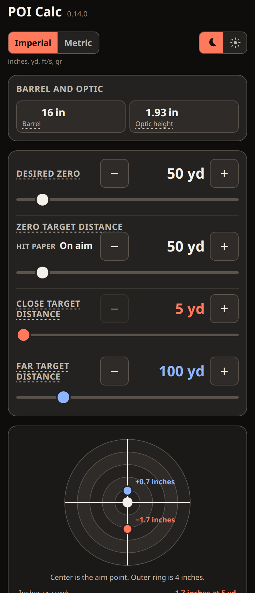

A fresh visit opens on the Tula steel-case .223 load, with that caliber expanded and the others collapsed. What you change is stored on the device, so the next visit comes back as you left it.

## Barrel, optic, and the zero

Barrel length and optic height are the two things the path needs from the gun.

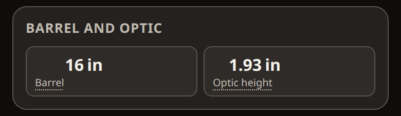

Barrel length is how long the barrel is. Catalog muzzle speed is the maker’s figure for that load’s reference barrel. Each inch longer or shorter shifts that speed by 25 feet per second. A longer barrel leaves faster, so the bullet spends less time falling and the path changes everywhere you read it. If you type a muzzle speed, that typed speed replaces the shift.

Optic height is how high the sight sits above the center of the bore. The bullet has to climb that distance to meet the line of sight at the zero. A higher sight means more climb, so the near misses and the shape of the arc both move.

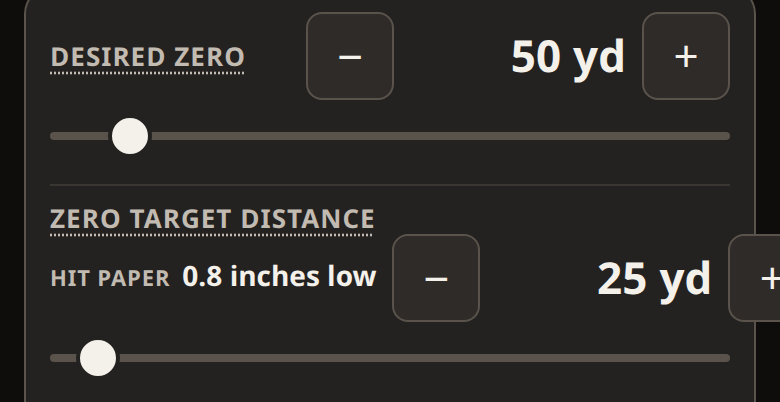

Desired zero is the distance where you want the bullet to cross the line of sight. That distance is the sight zero for the whole path. Move it and every later offset is recalculated.

Zero target distance is the paper you are actually shooting at while you zero. It is not another mark on the target or the plot. Hit paper is the offset at that paper for a path zeroed at the desired zero. Equal distances, or an offset smaller than a twentieth of an inch, read On aim. Otherwise it reads high or low, in inches or in millimeters. In the picture the desired zero is 50 yards and the paper is at 25, so the bullet is still low when it gets to the paper.

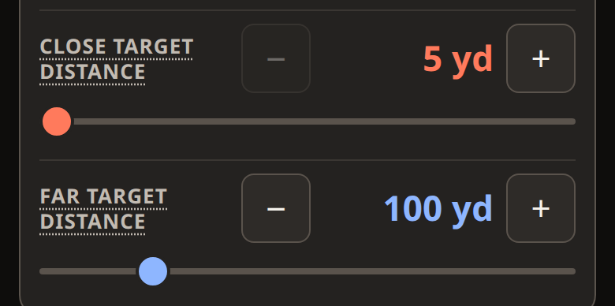

Close target distance is the nearer shot you want to see. Far target distance is the farther one. Close stays shorter than far. The coral mark is the close shot and the blue mark is the far shot. Changing either distance moves that dot on the bullseye and on the side view, and changes the offset printed next to it.

Sliders move by one. The plus and minus buttons step by five, in yards or in meters.

## Bullseye and the drop plot

The bullseye is the target, seen from the firing point. The center is the aim point. The coral dot is the close distance and the blue dot is the far distance. Each label is the offset from the aim point, not the distance: above the line of sight is positive, below it is negative. The caption under the rings tells you how large the outer ring is.

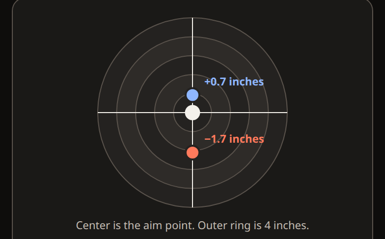

The drop plot is the same path from the side. The dashed line is the aim point. Inches are up and down. Yards, or meters, run along the bottom.

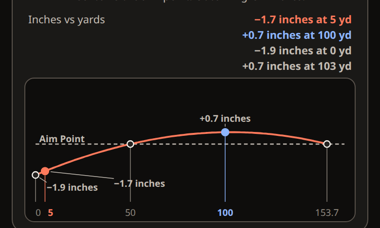

A dot that sits on the aim line is a crossing. It is labeled with the distance only, on a tick that drops to the axis. A dot that is off the line is labeled with its offset, and a thin leader ties that text to the dot. The close and far dots keep their offsets. The lowest and highest points of the path, inside the range drawn on the chart, are marked the same way and also get a distance tick. The list at the upper right repeats those offsets with the distance, including the minimum and the maximum.

## Ammunition

The three fields under the presets are the load that is in use: weight, muzzle speed, and G1 ballistic coefficient. They sit on one line. Weight is the bullet weight from the box. The path itself uses muzzle speed and G1 BC; weight is there so you can tell the loads apart. Muzzle speed is how fast the bullet leaves. A typed speed replaces the catalog speed. G1 BC is how well the bullet holds that speed on the G1 model. A higher number drops less.

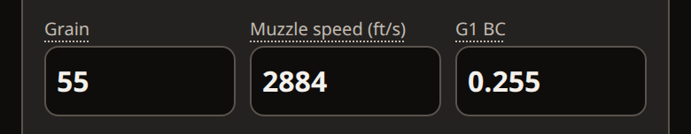

Catalog speeds and G1 figures are the published numbers stored in the app. Nothing in the list is estimated. If the maker did not publish a G1, that field is left blank until you type one. The plot waits for a coefficient rather than borrowing one from another load.

Presets are grouped by caliber, smaller first: .22 LR, 9mm Luger, .223 Rem, 5.56 NATO, then 7.62×39. Tap a group to open it, then tap a load to shoot that path. A fresh visit expands .223 and selects Tula.

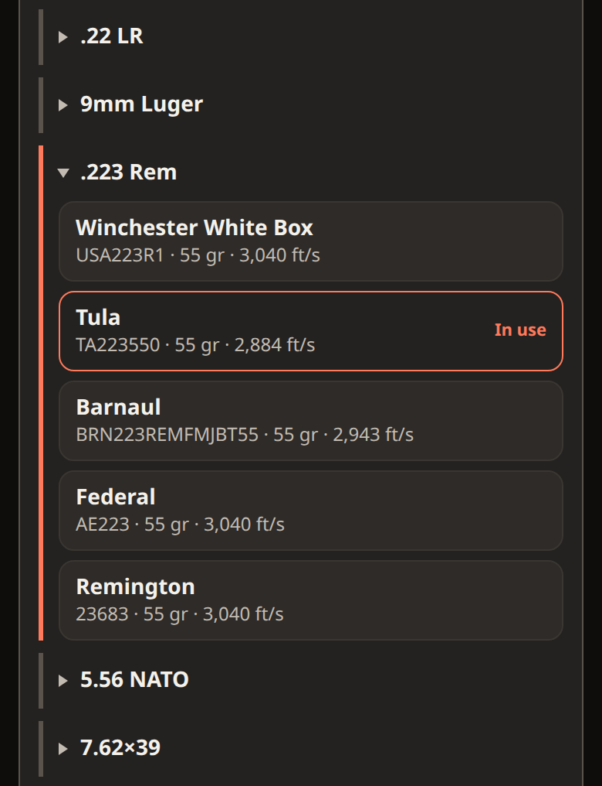

Under the list you can save a load that is not in the catalog. Brand, model, and UPC are optional. Caliber, weight, and muzzle speed are required. G1 BC stays empty unless you type it. The load is kept on the device with the rest of the setup.

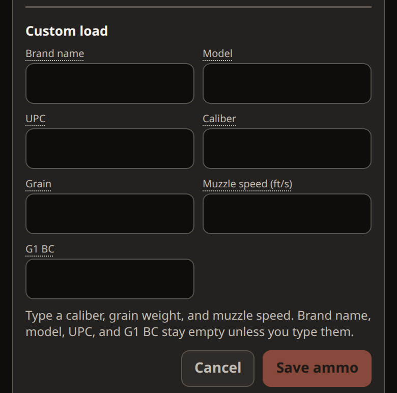

Imperial shows inches, yards, feet per second, and grains. Metric shows millimeters, meters, meters per second, and grams. The underlying shot does not change when you switch; only the numbers on the screen do. Dark and light are the same calculator with a different plate. The version beside POI Calc stays with whichever theme you pick.

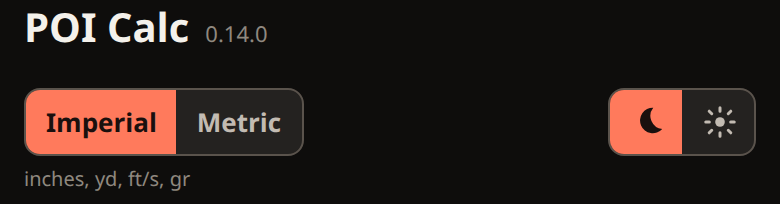

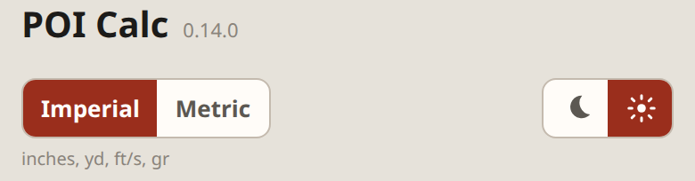
